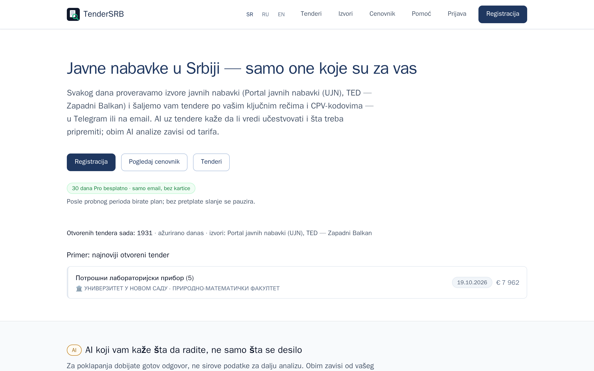
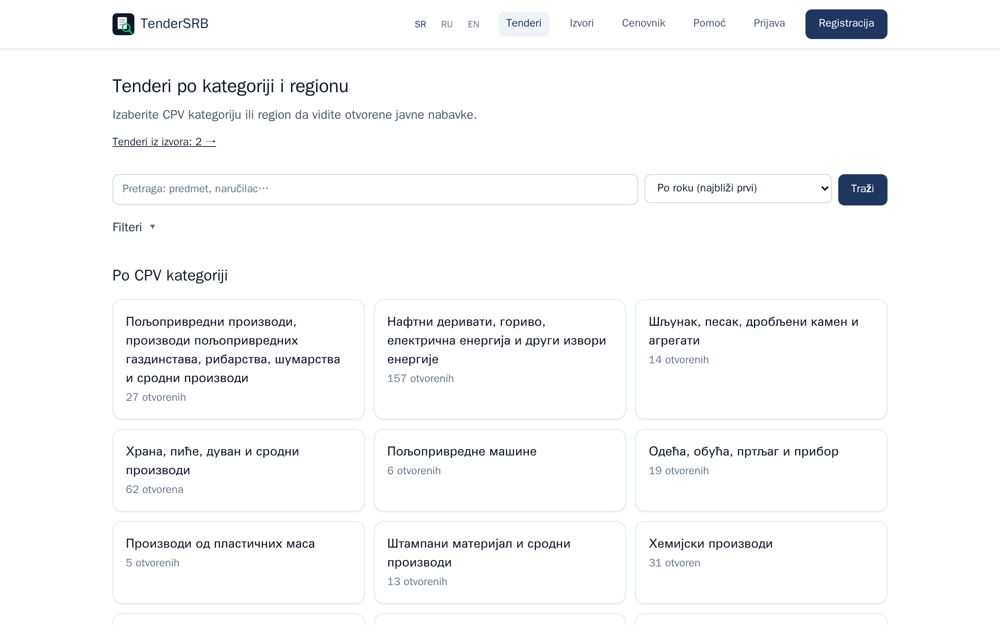
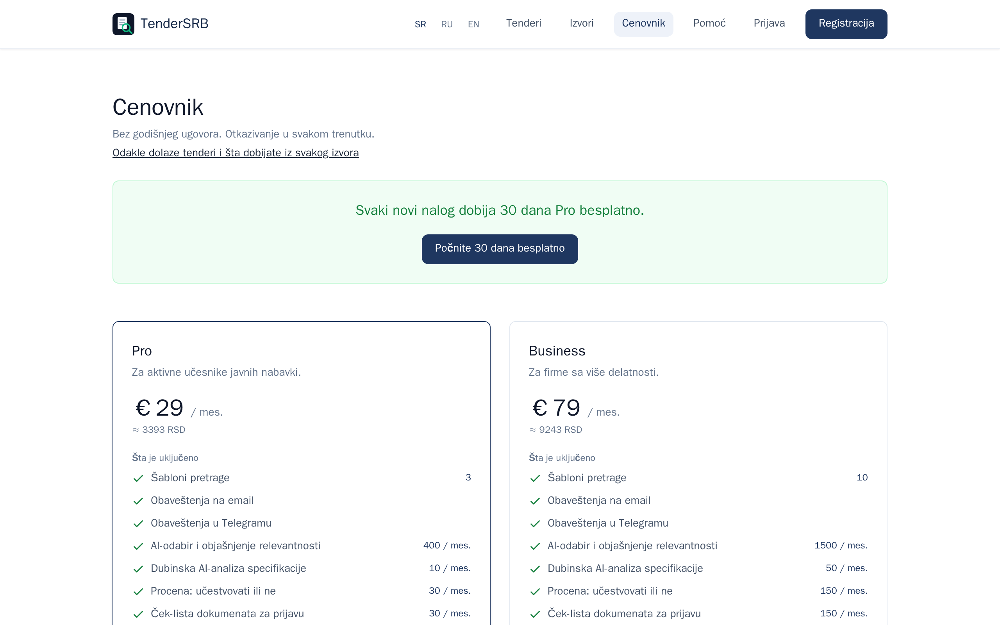
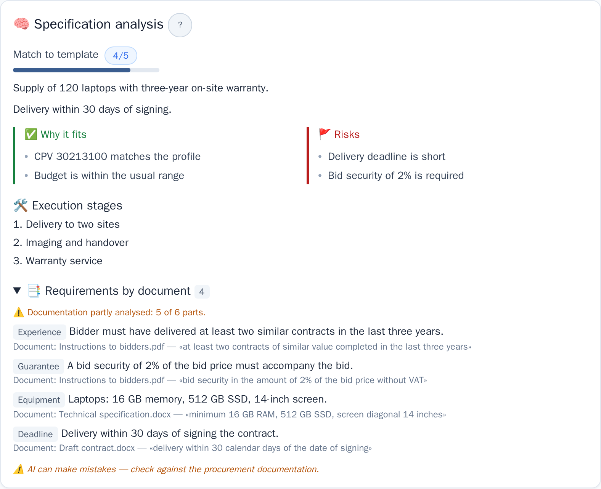
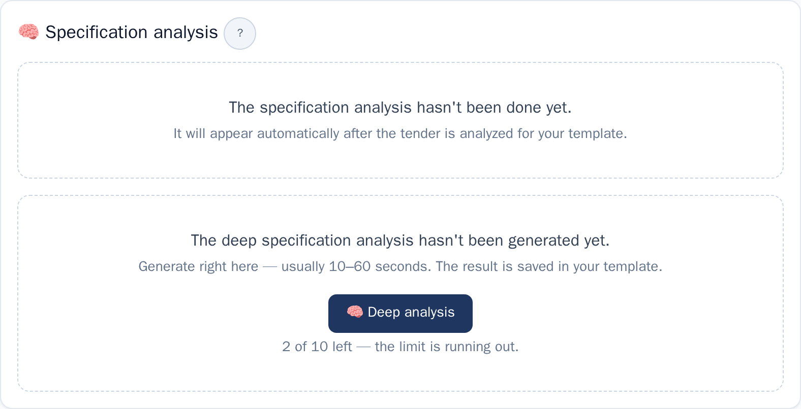
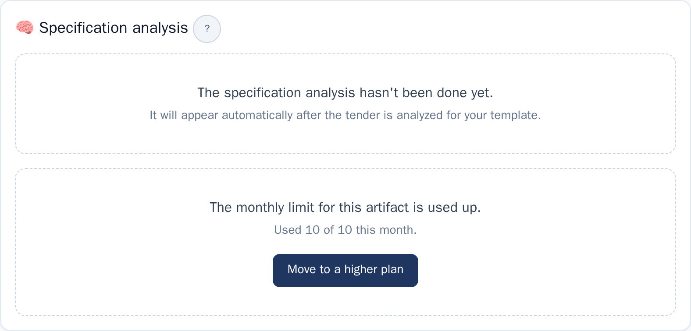
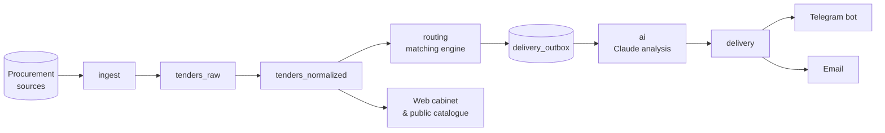

<div align="center">


# TenderSRB

**Serbian public tenders, filtered for you — with an AI that tells you whether to bid.**

[](https://app.nab.rs)
[](https://github.com/TnSrb1/nabrs/actions/workflows/ci.yml)
[](#numbers)
[](LICENSE)


[Live app](https://app.nab.rs) · [Architecture](docs/diagrams/architecture.svg) · [AI pipeline](docs/AI_PIPELINE.md) · [Agentic delivery](docs/AGENTIC_DELIVERY.md) · [Decisions (ADR)](docs/DECISIONS.md) · [Code map](docs/CODE_MAP.md) · [Database schema](docs/DB_SCHEMA.md)

</div>

---

## What this repository is

This is a **public snapshot of a private production repository**, exported from it at a single commit (see [`SHOWCASE_SOURCE`](SHOWCASE_SOURCE)). It has no git history and is refreshed by export, not by pushes.

What is intentionally **not** published:

- **Connectors to procurement portals.** Only the adapter contract (`src/parsers/base.py`, `capabilities.py`, `guards.py`, `registry.py`) and a demo adapter (`src/parsers/example/`) are included. The adapter code that talks to the live portals stays private.
- Deployment scripts (`deploy/`), server runbooks, operational state and internal working notes. The Dockerfile and `infra/config.yaml` are published.

Everything else — the web app, the Telegram bot, the workers, the database layer, the migrations and most of the tests — is the code that runs in production.

> **Language note:** the product interface, the tender data and the AI prompts are in Serbian and Russian on purpose, because they serve Serbian buyers and suppliers. Developer-facing text — code comments, docstrings, log and exception messages, CLI help and documentation — is in English.

## Screenshots

| Landing | Public tender catalogue | Pricing |
|:---:|:---:|:---:|
|  |  |  |

<sub>Production, Serbian locale, desktop. Captured with <code>scripts/shots/shot.sh</code>; the landing shot is dated 19 October 2026 on its tender card.</sub>

### AI analysis

| Requirements with exact quotes | Limit running out | Limit used up |
|:---:|:---:|:---:|
|  |  |  |

<sub>English locale, desktop width. Rendered by the real application on a fake database with an invented tender (no real data), with <code>scripts/shots/shot.sh</code>, 20 October 2026. How the analysis works: [AI pipeline](docs/AI_PIPELINE.md).</sub>

## What it does

- **Collects tenders** from Serbian public procurement portals and TED notices for the Western Balkans, normalised into one schema. Eight sources are enabled and seven have delivered data (see [Numbers](#numbers)); the rest of the registered adapters are switched off until enabled in the `sources` table.
- **Matches** every notice against each subscriber's templates: keywords (with Serbian Latin/Cyrillic folding and stemming), CPV codes, regions, budget and sources.
- **Explains with AI** — a relevance verdict, a deep analysis of the technical specification, a "bid or not" assessment and a document checklist. Usage is metered per plan.
- **Reads every document format** — `.pdf`, `.doc`, `.docx`, `.odt`, `.rtf`, `.xls`, `.xlsx`, `.txt` and `.zip` archives are turned into text; scanned files are marked, not silently skipped. Long documentation can be analysed step by step, with every requirement backed by an exact quote that a checker has found in the source. That mode is behind a feature flag and is off in production as of 20 October 2026. See [AI pipeline](docs/AI_PIPELINE.md).
- **Delivers** to Telegram ([@nabrs_bot](https://t.me/nabrs_bot)) and email, with deadline reminders, award notifications and a "tender changed" message (new deadline, amount or documents) to subscribers who already received the tender, at most once a day per tender.
- **Web cabinet** — a feed with sorting and filters, a template wizard built from ready-made packages, an account hub (plan, channels, templates) and a dashboard whose tabs switch without a page reload.
- **Public catalogue** — tenders by CPV category and a CPV code directory, indexed for search engines.
- **Procurement plans** (buyers' intentions before a tender exists) — collection is implemented behind a feature flag that is **off**; no plan data is collected or shown yet.
- **Three interface languages** — Serbian (Latin, default), Russian and English.

## Architecture



<sub>Animated: each data flow is highlighted in turn. Text version below.</sub>



Every stage is a standalone worker process. Stages communicate through PostgreSQL tables (an outbox pattern), so any worker can restart without losing work. The full diagrams are in [`docs/diagrams/`](docs/diagrams/), and the data model is in [`docs/DB_SCHEMA.md`](docs/DB_SCHEMA.md).

**Multi-tenancy is enforced in the database, not only in the code.** The API and the bot connect as a restricted role under `FORCE ROW LEVEL SECURITY`, and every tenant-scoped table carries its own policy.

| Layer | Technology |
|---|---|
| Web & API | FastAPI, Jinja2, htmx, pre-built Tailwind CSS, strict CSP (`script-src 'self'`) |
| Bot | aiogram 3 |
| Data | PostgreSQL 16 with pgvector, Redis 7, SQLAlchemy 2.0 (async) + asyncpg, Alembic |
| AI | Anthropic Claude for translation, relevance and specification analysis; per-plan limits and a usage ledger. Models are set in `infra/config.yaml` |
| Billing | Payment gateways behind one interface (Stripe and Paddle connectors, selected by config; implemented, not yet live) |
| Infra | Docker Compose, Caddy, Ubuntu 24.04 VPS |
| Quality | pytest, ruff, black, mypy ratchet, disposable PostgreSQL for database tests |

## How the AI part works



<sub>Animated: each stage is highlighted in turn. Details and the code behind each stage: [`docs/AI_PIPELINE.md`](docs/AI_PIPELINE.md).</sub>

## How it is built



<sub>Animated: each phase is highlighted in turn. Roles, rules and evidence: [`docs/AGENTIC_DELIVERY.md`](docs/AGENTIC_DELIVERY.md).</sub>

## Engineering practices

- **Row-level security with `FORCE`.** Every tenant-scoped table has a policy, `ENABLE` and `FORCE` row-level security. The application role is not the table owner, so the policy applies to it. Cross-tenant access goes only through `SECURITY DEFINER` functions. Integration tests run against a throwaway PostgreSQL instance.
- **Paid AI calls follow one rule set.** Each paid model call has a tier limit, a gate that runs *before* the call, and a usage record *after* it. Automatic analysis is also gated by subscription status, not only by plan.
- **Migrations are checked without a database.** Migration invariants are verified by rendering Alembic in offline SQL mode, and a single Alembic head is enforced before every push.
- **A quality gate before every PR.** `scripts/gate.sh` runs ruff, black, pytest with a 70% coverage floor and the mypy ratchet; run it locally before opening a pull request.
- **New tests are mutation-checked.** Each new test must turn red when the fix it guards is removed. Without this, a test only shows that the code runs.
- **Agent-assisted development with human ownership.** Work is split between a coordinator agent and worker agents (Claude Code), each on an isolated git worktree and a draft pull request, with a written verification report. The owner makes product and risk decisions and merges the high-risk paths (migrations, deployment, authentication, billing) personally.

## Numbers

As of 20 October 2026.

| Metric | Value |
|---|---|
| Tenders processed | 60,539 |
| Notifications delivered | 28,745 |
| Sources | 8 enabled, 7 with data (jnportal, bih_enabavke, cejn, nis, ted_balkan, worldbank, cfcu); the eighth has produced no tenders yet |
| Automated tests | 7,718 collected (private repository; this snapshot runs a subset, see [Running the tests](#running-the-tests)) |
| Database migrations | 58 (head `0058`) |
| Architecture decision records | 27 (in [`docs/DECISIONS.md`](docs/DECISIONS.md); 7 more are withheld because they contain operational or connector detail) |

## Repository layout

```text
src/
  api/        FastAPI app: public site, cabinet, admin, auth, templates, static
  bots/       Telegram bot (aiogram)
  workers/    ingest, routing, ai, delivery, reminders, reports — one process each
  parsers/    source adapter contract, registry and a demo adapter (example/)
  ai/         Claude client, prompts, tier limits
  billing/    payment gateways (Stripe, Paddle)
  db/         models and session (RLS-aware)
  domain/     pure logic: text normalisation, deadlines, matching rules
alembic/      database migrations
infra/        application configuration (config.yaml)
scripts/      gate.sh (pre-PR checks), code_map.py, shots/ (visual checks)
tests/        unit, API and database tests
docs/         architecture diagrams, ADRs, database schema, code map
```

## Running the tests

Requirements: Python 3.12. Database tests also need Docker or a local PostgreSQL 16.

```bash
git clone https://github.com/TnSrb1/nabrs.git
cd nabrs
python3 -m venv .venv && . .venv/bin/activate
pip install -e ".[dev]"

python3 -m pytest -q
```

Tests that need the unpublished connectors, deployment files or operational data are skipped by a `conftest.py` generated for this snapshot, so `python3 -m pytest -q` runs without flags and fewer tests run than in the private repository.

## Documentation

| Document | Purpose |
|---|---|
| [`docs/AI_PIPELINE.md`](docs/AI_PIPELINE.md) | The AI path of a tender: documents, gate, verdicts, step-by-step analysis, ledger |
| [`docs/AGENTIC_DELIVERY.md`](docs/AGENTIC_DELIVERY.md) | How the product is built with coordinator and worker agents under a human owner |
| [`docs/DECISIONS.md`](docs/DECISIONS.md) | Architecture Decision Records |
| [`docs/DB_SCHEMA.md`](docs/DB_SCHEMA.md) | Data model and row-level security |
| [`docs/CODE_MAP.md`](docs/CODE_MAP.md) | Where each route, table and module lives (generated) |
| [`docs/GLOSSARY.md`](docs/GLOSSARY.md) | Domain terms (Serbian and English) |
| [`docs/UI_SKILLS_ADAPTER.md`](docs/UI_SKILLS_ADAPTER.md) | Boundaries of the interface review skills |
| [`SECURITY.md`](SECURITY.md) · [`CONTRIBUTING.md`](CONTRIBUTING.md) | Reporting security issues and contribution rules |

## Contact

- Live app: [app.nab.rs](https://app.nab.rs)
- Telegram bot: [@nabrs_bot](https://t.me/nabrs_bot)
- Project channel (news and beta testing): [t.me/nabrs_news](https://t.me/nabrs_news)

## License

Proprietary. Copyright © 2026 TenderSRB. All rights reserved — see [LICENSE](LICENSE). This repository is published for reading and evaluation; no license is granted to use or redistribute its contents.
