# CODE_MAP — module map



<sub>Animated: package groups are highlighted in turn. Packages and links are computed from the imports of this snapshot.</sub>

**Derived document.** Generated from the code at `a42a7882`. Regeneration: `python3 scripts/code_map.py`.
If the map and the code disagree, **the code is right** — do not edit the map by hand, except the section “Where to look” (it lives in `scripts/code_map.py`).

Volume: **218 modules** in `src/`, **68 466 lines** of Python.

## Checking the map against fact

The map is a hypothesis, production is a fact. Both checks are read-only, both are done from the development clone:

```
# routes: the number of paths in the live app’s schema (compare with the “Routes” section)
docker compose -f deploy/docker-compose.yml exec -T api python -c \
  "from src.api.main import app; print(len(app.openapi()['paths']))"

# tables: the list from the live DB (compare with the “DB tables” section)
docker compose -f deploy/docker-compose.yml exec -T postgres bash -lc \
  'psql -U $POSTGRES_USER -d $POSTGRES_DB -c \"\\dt\"'
```

As of 10.08.2026 checked: **72 of 72** paths matched in both directions; **41 of 42** tables (the divergence — the service table `alembic_version`).

## Where to look (predicates)

| Question | Predicate (not a retelling) |
| --- | --- |
| Where is an interface string? | `grep -rn "<string>" src/api/*/i18n.py src/i18n_common.py src/i18n_email.py` |
| Where is an entity rendered? | `grep -rln "<partial>.html" src/api/templates/` — edit ALL the points, not one |
| Who touches the table? | `grep -rn "<table>" src/ --include=*.py` + `grep -rn "<table>" alembic/versions/` |
| Does the table have RLS? | `grep -rn "FORCE ROW LEVEL SECURITY" alembic/versions/ \| grep <table>` |
| Where is the tier/limit gate? | `src/ai/usage.py` (`_TIER_LIMITS`), `src/plans/catalog.py`, `src/api/deps.py` |
| Where is access granted? | `src/domain/access.py`, `src/domain/access_grants.py` — the single point |
| Which route serves the screen? | `grep -rn "<template>.html" src/api/` |
| Where is the CSS class defined? | `grep -n "<class>" src/api/static/app.css` (there is NO Tailwind build) |
| What does migration N change? | `alembic/versions/` — the file by number; heads: `alembic heads` (in the development clone) |
| A cross-tenant operation? | `grep -rn "app_admin_\|app_resolve_" src/ alembic/versions/` — only SECURITY DEFINER |

## Entry points

| What | File | How it is launched |
| --- | --- | --- |
| HTTP API + cabinet + showcase | `src/api/main.py` | uvicorn, service `api` |
| Telegram bot | `src/bots/telegram.py` | service `bot` |
| Migrations | `alembic/` | `docker compose run --rm migrate` |
| Workers (21) | `src/workers/` | separate compose services |

## Packages of `src/`

### `src/` — 4 modules, 1391 lines

| Module | Lines | Purpose (docstring) |
| --- | ---: | --- |
| `i18n_email.py` | 750 | Catalog of the e-mail chrome (sr/ru/en) — a SINGLE source for two surfaces |
| `i18n_common.py` | 575 | Shared bot↔cabinet vocabulary — a SINGLE source for both surfaces |
| `log_secrets.py` | 64 | Masking of secrets in the httpx log (a common module for all workers and the bot) |
| `__init__.py` | 2 | Tender Bot Serbia — application source root |

### `src/ai/` — 10 modules, 3552 lines

| Module | Lines | Purpose (docstring) |
| --- | ---: | --- |
| `usage.py` | 628 | Shared helpers for AI usage accounting (§14.5) |
| `client.py` | 618 | Wrapper over the Anthropic SDK (ARCHITECTURE §9 “AI Service Layer”, §14.6–14.7) |
| `prompts.py` | 599 | Prompts of the AI pipeline v2 — reworked after the patterns of a production tool layer |
| `stepwise.py` | 567 | Step-wise (Markovian) AI analysis of tender documentation — levels ``deep`` and ``checklist`` |
| `translation.py` | 528 | Translation of a tender card sr→ru over the original, with a Redis cache (VG-26) |
| `schemas.py` | 269 | Pydantic schemas of the JSON output of AI models (ARCHITECTURE §14.2 L1, §14.3 L2, §14.4 L3) |
| `profile_context.py` | 142 | Single builder of the supplier-profile context string for AI prompts |
| `track_record.py` | 122 | Behavioral memory of the company — a compact track record from ``tender_user_status`` |
| `translate_prompts.py` | 51 | Prompt for translating a tender card sr→ru (VG-26) |
| `__init__.py` | 28 | AI Service Layer (ARCHITECTURE §9, §14) |

### `src/analytics/` — 4 modules, 1959 lines

| Module | Lines | Purpose (docstring) |
| --- | ---: | --- |
| `awards_analytics.py` | 960 | VG-06 — analytics of the contracting authority and competitors over ``tender_awards`` |
| `report_builder.py` | 785 | The report builder “Analitika” (R4, owner decision 10.10.2026) — the SQL layer |
| `reprocurement.py` | 207 | VG-07 phase-1 — the reprocurement forecast (reprocurement forecast) |
| `__init__.py` | 7 | Analytics over tender_awards (VG-05 → VG-06) |

### `src/api/` — 17 modules, 3326 lines

| Module | Lines | Purpose (docstring) |
| --- | ---: | --- |
| `repo.py` | 579 | A thin DB-access layer for the cabinet (Sprint-19) |
| `deps.py` | 423 | The FastAPI dependencies of the cabinet (Sprint-19) |
| `templating.py` | 369 | The common Jinja2 renderer of the cabinet (ADR-007: FastAPI + Jinja2 + HTMX + Tailwind) |
| `forms.py` | 294 | Parsing and validation of the profile HTMX forms (Sprint-19) |
| `main.py` | 269 | FastAPI application (ADR-006) · 1 route(s) |
| `anti_abuse.py` | 252 | Registration anti-abuse layer (ADR-018 revised, ARCHITECTURE §4) |
| `emailer.py` | 241 | Sending transactional mail (ARCHITECTURE §9) |
| `security.py` | 191 | The signature of the session cookie and the work with one-off tokens (Sprint-19) |
| `tiers.py` | 180 | The plan gate for profiles (ARCHITECTURE §12.1 / §12.4, ADR-018 revised) |
| `config.py` | 115 | The cabinet web configuration (pydantic-settings, Sprint-19) |
| `pager.py` | 90 | The window of page numbers for the pager (shared by the cabinet and the showcase) |
| `nav_access.py` | 79 | The tenant’s access for the cabinet header: the status badge and the plan marks on the tools |
| `admin_notify.py` | 62 | Best-effort notification of platform operators by email |
| `rate_limit.py` | 61 | In-memory rate limit for the public points of the cabinet (STAGE 2, security minimum) |
| `admin_access.py` | 60 | Single source of truth about who is a platform operator |
| `static_assets.py` | 59 | Static version: ``?v=`` in the address and ``Cache-Control`` by it (TASK static-cache) |
| `__init__.py` | 2 | FastAPI application package (ADR-006) |

### `src/api/admin/` — 4 modules, 2252 lines

| Module | Lines | Purpose (docstring) |
| --- | ---: | --- |
| `admin_service.py` | 1333 | Admin cabinet service (EPIC 6) |
| `routes_admin.py` | 640 | Administrative cabinet (EPIC 6) · prefix `/admin` · 23 route(s) |
| `sources_admin.py` | 278 | “Izvori” admin — management of sources (SRC-0d, owner decision 30.09 item 5) |
| `__init__.py` | 1 | — |

### `src/api/billing/` — 2 modules, 103 lines

| Module | Lines | Purpose (docstring) |
| --- | ---: | --- |
| `routes_billing.py` | 101 | Billing routes (VG-11.1): the provider webhook and checkout from the cabinet · 2 route(s) |
| `__init__.py` | 2 | HTTP layer of billing (VG-11.1): the provider webhook + checkout from the cabinet |

### `src/api/cabinet/` — 44 modules, 19226 lines

| Module | Lines | Purpose (docstring) |
| --- | ---: | --- |
| `i18n.py` | 4614 | Multilingual cabinet — sr/ru/en. Phase 1.1: framework + switcher |
| `routes_profiles.py` | 1538 | Cabinet profile routes (ARCHITECTURE §12) · 19 route(s) |
| `feed_service.py` | 1191 | Delivery feed + burning deadlines + visible AI actions (VG-28.3b-BE) |
| `customer_analytics_service.py` | 897 | The contracting-authority analytics of the tender in the web cabinet (web-ai-3/4, steps 3–4) |
| `workflow_service.py` | 828 | Service of the cabinet workflow / retention (VG-17): folders, notes, watching |
| `routes_tender_ai.py` | 827 | Routes of the tender AI artifacts in the cabinet (web-ai-1 view + web-ai-2 generation) · 6 route(s) |
| `preview_service.py` | 708 | Preview of “how many tenders would fit in a month” (EPIK 3) |
| `channel_service.py` | 636 | Cabinet channel-binding service (Chat 26, T3 — cabinet↔bot linkage, C-04) |
| `auth_service.py` | 619 | Cabinet authentication service (ARCHITECTURE §4, ADR-018 revised) |
| `analitika_service.py` | 612 | The “Analitika” page in the cabinet — a report builder with export to Excel (R4) |
| `routes_auth.py` | 485 | Cabinet authentication routes (ARCHITECTURE §4, ADR-018 revised) · 11 route(s) |
| `vertical_packages.py` | 480 | The SSOT catalog of the profile vertical packages (VG-14) |
| `tender_ai_generate.py` | 440 | Web generation of AI artifacts from the cabinet (web-ai-2, step 2) |
| `profile_service.py` | 398 | Cabinet profile service (ARCHITECTURE §12, DB_SCHEMA §2.6/§2.7) |
| `market_service.py` | 374 | “Market” — the Vesti dashboard tab (owner 13.10, step 3) |
| `routes_my_tenders.py` | 357 | Workflow / retention routes of the cabinet (VG-17): folders, notes, watching · 10 route(s) |
| `routes_account.py` | 317 | The “My account” section of the cabinet (owner 20.09.2026, additional owner 22.09.2026) · 3 route(s) |
| `template_library_service.py` | 284 | Service of the search-template library (EPIK 4 + EPIK 5) |
| `narucilac_page_service.py` | 266 | Customer analytics page in the cabinet (A3, VG-06 lite) |
| `routes_library.py` | 264 | Routes of the search-template library (EPIK 4) · 2 route(s) |
| `routes_channels.py` | 262 | Channel-binding routes of the cabinet (Chat 26, T3 — the cabinet↔bot stitching, C-04) · 7 route(s) |
| `source_banner.py` | 252 | The banner “enable a source in all templates” and the honest figure “you have K of N” |
| `trial_service.py` | 236 | The trial-access service for the cabinet (STAGE T) |
| `account_export_service.py` | 203 | “Download my data” export from the cabinet (LEG-06, second half, owner 14.10.2026) |
| `competition_service.py` | 199 | The “Konkurencija” block on the tender card: who won before (owner 13.10, step 4) |
| `tender_ai_service.py` | 194 | Read-only view of the tender’s AI artifacts in the web cabinet (web-ai-1, step 1) |
| `library_sectors.py` | 187 | One showcase of templates by industry (owner complaint 01.10.2026: “all over the place, in one heap”) |
| `account_delete_service.py` | 181 | Self-deletion of an account from the cabinet (LEG-06, owner 10.10.2026) |
| `stats_service.py` | 177 | Dashboard statistics of the cabinet (Track A) |
| `ai_limits_service.py` | 113 | The tenant’s remaining AI limits for display in the cabinet (read-only) |
| `template_prefill.py` | 112 | The profile prefill from a library template / a vertical package — ONE point |
| `my_tenders_export.py` | 108 | F2 — assembly of the CSV export “My tenders” |
| `routes_narucilac.py` | 107 | Route of the “Customer analytics” page in the cabinet (A3, VG-06 lite) · 2 route(s) |
| `subscription_service.py` | 106 | Reading the tenant’s subscription for the “My subscription” section of the cabinet (VG-11.2) |
| `routes_subscription.py` | 105 | The “My subscription” section of the cabinet (VG-11.2) — now a section of the “Moj kabinet” hub · 1 route(s) |
| `routes_locale.py` | 86 | Interface language switcher of the cabinet (Phase 1.1) · 1 route(s) |
| `customer_suggest.py` | 85 | Suggestions of contracting authorities for the profile filters “follow / exclude” (0046) |
| `analitika_xlsx.py` | 82 | Excel export of the “Analitika” report builder (R4) |
| `routes_analitika.py` | 78 | Routes of “Analitika” — the report builder with Excel export (R4) · 2 route(s) |
| `routes_trial.py` | 78 | Route for requesting a trial access from the cabinet (STAGE T) · 1 route(s) |
| `library_counts.py` | 67 | Live figure “≈ N tenders in 30 days” for the showcase cards on /library |
| `source_choices.py` | 36 | The platform checkbox rows — one set for the template form, “Composition” and “as is” |
| `tender_path.py` | 35 | Normalisation of ``{tender_id}`` in the cabinet paths ``/app/tenders/{id}…`` (#632) |
| `__init__.py` | 2 | Subscriber web cabinet (FastAPI + Jinja2 + HTMX + Tailwind, ADR-007) |

### `src/api/public/` — 18 modules, 7567 lines

| Module | Lines | Purpose (docstring) |
| --- | ---: | --- |
| `i18n.py` | 3012 | The minimal language mechanism of the public pages of the showcase (TASK 1, SITE-04) |
| `routes_geo.py` | 716 | GEO-2: landing pages ``/tenderi`` — “by CPV section” and “by region” · 4 route(s) |
| `legal_texts.py` | 663 | Drafts of the legal texts of the showcase (TASK 2, SITE-05) |
| `routes_public.py` | 514 | The public marketing and legal routes of the showcase (TASK 1/2, SITE-01/04/05) · 7 route(s) |
| `news.py` | 437 | Product news (owner 10.10.2026, ANALYTICS_PRODUCT §7): once — three languages |
| `routes_seo.py` | 366 | GEO / SEO foundation: robots.txt, sitemap.xml (+ chunks), llms.txt, favicon · 8 route(s) |
| `stats_page.py` | 316 | The data of the public “Statistics” showcase (``GET /statistika``, R3 ANALYTICS_PRODUCT) |
| `portal_filters.py` | 284 | The filters and sorting of the public portal ``/tenderi`` (TASK portal_filters) |
| `routes_tender.py` | 269 | The public tender card ``/tender/{id}`` (ARCHITECTURE §5.2) · 2 route(s) |
| `routes_contact.py` | 225 | The feedback form: GET / POST /kontakt — the ONLY receiver for all forms · 2 route(s) |
| `sources_view.py` | 190 | The list of enabled sources for the showcase and help (SRC-0d, owner’s decision R7) |
| `sources_page.py` | 178 | Data of the “Sources” showcase (``GET /izvori``) |
| `routes_news.py` | 111 | Product news: GET /novosti, GET /novosti/{slug}, POST /novosti/procitano · 3 route(s) |
| `geo_cache.py` | 109 | In-process TTL cache of the ``/tenderi`` aggregates (CPV sections, regions) |
| `home_ai_example.py` | 65 | A static snapshot of a real AI analysis for the home page (UX audit P1, owner 10.10) |
| `cpv_directory.py` | 59 | The CPV directory for ``/cpv-kodovi``: the tree of sections → groups, and the labels by language |
| `trial_text.py` | 51 | The trial period length in the showcase texts: one source — ``settings.trial_days`` |
| `__init__.py` | 2 | Public routes (no authorization): the tender card, the webhooks (later) |

### `src/billing/` — 8 modules, 1053 lines

| Module | Lines | Purpose (docstring) |
| --- | ---: | --- |
| `service.py` | 336 | The core of applying billing events (VG-11.1) |
| `stripe.py` | 230 | The Stripe connector (VG-11.1) — all the Stripe specifics are isolated here |
| `paddle.py` | 189 | The Paddle Billing connector (VG-11.1) — all the Paddle specifics are isolated here |
| `registry.py` | 126 | Registry of the payment connectors (VG-11.1) |
| `gateway.py` | 59 | Abstraction of the payment gateway (VG-11.1) |
| `models.py` | 57 | Provider-neutral billing models (VG-11.1) |
| `util.py` | 36 | Small provider-neutral helpers for the connectors (VG-11.1) |
| `__init__.py` | 20 | Universal payment connector (VG-11.1) |

### `src/bots/` — 22 modules, 9074 lines

| Module | Lines | Purpose (docstring) |
| --- | ---: | --- |
| `telegram.py` | 3410 | Telegram bot (aiogram 3) — ARCHITECTURE §9, §12, ADR-006 |
| `i18n.py` | 931 | The catalog of the Telegram bot chrome — sr/ru/en (i18n Phase 2a: the INCOMING handlers) |
| `awards_analytics_service.py` | 650 | On-demand analytics of the contracting authority (VG-06) — the service for the Telegram button |
| `manage.py` | 548 | Management from the bot: “📋 My tenders” (``/list``) and the template pause (``/pause``) |
| `compliance_checklist_service.py` | 377 | On-demand checklist “what to prepare” (VG-09) — the service for the button “📋 What to prepare?” |
| `deep_analysis_service.py` | 374 | On-demand L3 deep analysis (§14.4) — the service for the Telegram button “🧠 Deep analysis” |
| `draft_service.py` | 331 | On-demand AI bid draft (VG-10) — the service for the button “📝 Bid draft” |
| `bid_verdict_service.py` | 300 | On-demand bid/no-bid verdict (VG-08) — the service for the Telegram button “🎯 Is it worth it?” |
| `i18n_ai_render.py` | 284 | The chrome of the bot’s AI wrapper (deep analysis, verdict, checklist, draft, analytics, |
| `source_choice.py` | 265 | ``/izvori`` — the subscriber chooses the profile’s sources in the bot (SRC-0b, R6) |
| `trial_service.py` | 246 | The service of the decisions on the trial access for the Telegram bot (STAGE T) |
| `award_watch_service.py` | 234 | The service of subscriptions to winners (VG-06 E3b) — the business logic for the Telegram handlers |
| `status_service.py` | 227 | The service of the tender status funnel for the Telegram bot (a port of v6 tracker_bot) |
| `trial_handlers.py` | 211 | The handlers of the trial access for the Telegram bot (STAGE T) |
| `analytics_export.py` | 170 | VG-06 STAGE 3a — export of the analytics of the contracting authority/competitor to CSV |
| `tg_html.py` | 111 | The splitting of the HTML reply of the bot into Telegram messages (the limit of 4096 characters) |
| `ai_gate.py` | 110 | Read-only AI-level gate reader for the Telegram handlers (#513) |
| `card_stash.py` | 81 | The stash of the collapsed tender card (“✖ Hide” → “↩ Restore”) |
| `sr_latin.py` | 78 | The Serbian in the bot — Latin only (owner 10.10.2026) |
| `config.py` | 75 | The configuration of the bots (pydantic-settings) |
| `requirements_render.py` | 55 | Block "Requirements by document" for Telegram (stepwise): ≤10 main ones + a reference to the site |
| `__init__.py` | 6 | Messenger bots (ARCHITECTURE §9) |

### `src/db/` — 3 modules, 152 lines

| Module | Lines | Purpose (docstring) |
| --- | ---: | --- |
| `session.py` | 123 | A minimal async layer of SQLAlchemy 2.0 sessions |
| `base.py` | 17 | SQLAlchemy 2.0 declarative base for Tender Bot Serbia |
| `__init__.py` | 12 | Database layer for Tender Bot Serbia |

### `src/db/models/` — 18 modules, 1623 lines

| Module | Lines | Purpose (docstring) |
| --- | ---: | --- |
| `tenant.py` | 192 | Tenant and account models · tables: `tenants`, `users`, `user_channels`, `subscriptions`, `anti_abuse_identifiers` |
| `tender.py` | 161 | Two-tier tender models + canonical clustering · tables: `tenders_raw`, `canonical_tenders`, `tenders_normalized` |
| `profile.py` | 136 | Subscriber search-profile models · tables: `profiles`, `profile_revisions` |
| `workflow.py` | 126 | Workflow/retention: folders, membership, notes (VG-17, migration 0029) · tables: `tender_folders`, `folder_items`, `tender_notes` |
| `geo.py` | 104 | Foundational reference tables (multi-country foundations, ADR-033) · tables: `countries`, `classification_systems`, `classifications`, `regions` |
| `tender_status.py` | 97 | The user’s funnel of tender statuses within a tenant (migration 0008) · tables: `tender_user_status` |
| `__init__.py` | 92 | ORM models for Tender Bot Serbia (DB_SCHEMA.md v1.1 + auth_tokens) |
| `ai.py` | 83 | AI pipeline models (ADR-024) · tables: `tender_ai_analyses`, `ai_usage` |
| `award_watch.py` | 81 | ORM models for the alerts about winners (VG-06 E3b, migration 0019) · tables: `award_watch_subscriptions`, `award_watch_sent` |
| `tender_award.py` | 77 | ORM model TenderAward — the award decisions of tenders (F03 eNabavke) · tables: `tender_awards` |
| `billing.py` | 76 | Billing models (VG-11.1, migration 0028) · tables: `billing_subscriptions`, `billing_webhook_events` |
| `delivery.py` | 69 | Delivery outbox models (outbox pattern, ADR-025) · tables: `delivery_outbox`, `delivery_attempts` |
| `template_library.py` | 66 | Template library model (EPIC 4 — the library of ready-made search templates) · tables: `template_library` |
| `reminder_log.py` | 60 | The journal of sent deadline reminders (migration 0009) · tables: `reminder_log` |
| `channel_dead_notice_log.py` | 56 | The journal of the incidents “the delivery channel dropped” (migration 0031) · tables: `channel_dead_notice_log` |
| `summary_log.py` | 55 | The journal of sent daily summaries (migration 0010) · tables: `summary_log` |
| `auth.py` | 53 | The one-time auth tokens of the cabinet (Sprint-19, + channel_bind since Chat 26) · tables: `auth_tokens` |
| `source.py` | 39 | Tender source runtime config · tables: `sources` |

### `src/dedup/` — 5 modules, 732 lines

| Module | Lines | Purpose (docstring) |
| --- | ---: | --- |
| `cross_source.py` | 312 | The scoring of a pair “the same procurement on two sources” (TED ↔ jnportal) |
| `linker.py` | 255 | Binding a tender to the cross-source cluster at ingest (owner decision 01.10.2026) |
| `cluster_key.py` | 107 | compute_cluster_key — a deterministic key of the cross-platform deduplication |
| `also_on.py` | 56 | The mark “the same tender is also on other sources” — ONE predicate for all renderings |
| `__init__.py` | 2 | Cross-platform deduplication of tenders (ADR-022 + ADR-033, DB_SCHEMA §7) |

### `src/domain/` — 23 modules, 2402 lines

| Module | Lines | Purpose (docstring) |
| --- | ---: | --- |
| `text_norm.py` | 371 | A single contract for normalizing Serbian text for matching (research §6) |
| `sources.py` | 295 | The registry of source sources — the ``sources`` table as the single list (SRC-0a) |
| `tender_changes.py` | 234 | Tender changes (World Model): a structural "was → became" diff and its rendering |
| `classifications.py` | 175 | A single dictionary of classification systems: tender side ↔ profile side |
| `ics.py` | 155 | An iCalendar (RFC 5545) generator for “Add to calendar” — the tender submission deadline |
| `tz.py` | 143 | The project’s single time contract: in the DB and in logic — UTC ONLY |
| `access.py` | 142 | The SSOT predicate of a tenant's access activity/freeze (FIX-SG-01) |
| `repoll.py` | 104 | Re-polling of open tenders: periodicity and the per-pass ceiling |
| `indexing.py` | 79 | Which tender cards we give to search engines (sitemap + ``robots``) |
| `access_grants.py` | 78 | The single point of EXTENDING a tenant’s access by N days (migration 0041) |
| `description_render.py` | 76 | Parsing a tender description into “document heading + text” blocks |
| `regions.py` | 74 | The SSOT directory of Serbian districts (ISO 3166-2:RS, RS-00..RS-29) for the UI |
| `actuality.py` | 71 | A tender without a submission deadline is current for :data:`NO_DEADLINE_ACTUAL_DAYS` days |
| `tiers.py` | 61 | The SSOT resolver of the effective tier for AI gates (a neutral domain layer) |
| `audit.py` | 57 | A neutral layer for writing to the immutable admin log (``admin_audit_log``) |
| `delivery_cap.py` | 55 | The daily delivery limit: ONE place for the figure and the warning threshold |
| `live_tender.py` | 52 | The “live tender” predicate and the start of regular collection — ONE for the cabinet dashboard and the ``/statistika`` storefront |
| `profile_channels.py` | 50 | Channel attached AFTER the template was created — to templates without channels |
| `source_reconcile.py` | 49 | Reconciliation with the source (M2 of monitoring): one “discrepancy” predicate and the alert text |
| `source_silence.py` | 35 | Source silence: hours of quiet and the “time to alert” decision (SRC-0d) |
| `seo_text.py` | 24 | Cleaning tender text for SEO surfaces (title/meta/JSON-LD) |
| `ids.py` | 20 | The canonical form of identifiers from URLs |
| `__init__.py` | 2 | The domain layer: pure business logic without DB/IO (FIX-SG-01) |

### `src/parsers/` — 5 modules, 1002 lines

| Module | Lines | Purpose (docstring) |
| --- | ---: | --- |
| `guards.py` | 530 | Source reliability guards: robots · HTTP class · silent zero · canary |
| `base.py` | 249 | SourceAdapter — the single interface of tender sources (ADR-021) |
| `capabilities.py` | 177 | What the client gets from the source — the declaration of the adapter’s capabilities |
| `__init__.py` | 27 | Source adapters package (ADR-021) |
| `registry.py` | 19 | Loading source adapters into the registry |

### `src/parsers/example/` — 2 modules, 83 lines

| Module | Lines | Purpose (docstring) |
| --- | ---: | --- |
| `adapter.py` | 81 | Demo adapter ``example`` — the reference of the :class:`SourceAdapter` contract |
| `__init__.py` | 2 | Demo adapter: reads the local ``sample.json``, uses no network |

### `src/plans/` — 2 modules, 444 lines

| Module | Lines | Purpose (docstring) |
| --- | ---: | --- |
| `catalog.py` | 443 | SSOT catalog of the public plans of the showcase (VG-12) |
| `__init__.py` | 1 | — |

### `src/workers/` — 22 modules, 10912 lines

| Module | Lines | Purpose (docstring) |
| --- | ---: | --- |
| `ingest.py` | 2270 | Ingest Worker — the entry of the pipeline: ``fetch_batch → tenders_raw → tenders_normalized`` |
| `matching.py` | 1355 | Two-stage matching of a tender against the subscribers' profiles |
| `delivery.py` | 994 | Delivery Worker — sends tenders from ``delivery_outbox`` to the channels |
| `award_watch_notifier.py` | 618 | Award Watch Notifier — push alerts about new wins of the subscribed PIBs (VG-06 E3b) |
| `flow_observability.py` | 557 | Observability of the tender flow and the card enrichment (REV-07, owner 20.09.2026) |
| `subscription_reminders.py` | 504 | Subscription Reminder Worker — reminders about the subscription expiry |
| `ai.py` | 503 | AI Worker — analysis of the specification from ``delivery_outbox`` (the pipeline ``ai_pending → ai_done``) |
| `ai_spend_report.py` | 481 | AI Spend Report — the daily summary of Anthropic spend + an alert to the operator |
| `channel_dead_notify.py` | 455 | Channel Dead Notify Worker — an e-mail to the subscriber about a dropped delivery channel |
| `tender_change_notifier.py` | 452 | Tender Change Notifier — "tender changed" to subscribers to whom it has already been delivered |
| `summary.py` | 397 | Summary Worker — the daily summary of the subscriber's funnel (the port of v6 daily_summary) |
| `reminders.py` | 370 | Reminder Worker — reminders about an approaching deadline (the port of v6 reminders_loop) |
| `billing_notifications.py` | 369 | Billing Notifications Worker — payment lifecycle e-mails (blocker #3) |
| `routing.py` | 318 | Routing Worker — a LISTEN/NOTIFY loop over the channel ``tender_changed`` |
| `flow_report.py` | 303 | Flow Report — the daily summary “flow and enrichment” (REV-07, owner 20.09.2026) |
| `news_autopost.py` | 271 | Automatic publication of news ``/novosti`` to the Telegram channel (owner decision 16.10.2026) |
| `health.py` | 265 | Worker observability: heartbeat (Healthchecks.io) + Telegram alert (REV-05/06) |
| `source_reconcile.py` | 237 | The daily reconciliation of the number of notices with the source (M2, ``docs/development/SOURCE_MONITORING_2026-10-15.md``) |
| `keyword_expand.py` | 144 | Expansion of ru/en keywords → Serbian word forms in Cyrillic (+ en-forms for English-language sources) |
| `__init__.py` | 21 | Background workers of Tender Bot Serbia |
| `alsu_collector.py` | 14 | Snapshot stub: the property-sales collector of a specific source is not published |
| `plans_collector.py` | 14 | Snapshot stub: the procurement-plan collector of a specific source is not published |

### `src/workers/adapters/` — 5 modules, 1613 lines

| Module | Lines | Purpose (docstring) |
| --- | ---: | --- |
| `base.py` | 655 | The contract of the channel delivery adapter (ARCHITECTURE §15.1, ADR-025) |
| `email.py` | 453 | The Email delivery adapter for tenders (ARCHITECTURE §15.1, ADR-025) |
| `telegram.py` | 388 | The Telegram delivery adapter (aiogram 3, ARCHITECTURE §15, ADR-025) |
| `__init__.py` | 85 | Channel delivery adapters (ARCHITECTURE §15.1, ADR-025) |
| `viber.py` | 32 | The Viber delivery adapter — a STUB (ARCHITECTURE §15.1) |

## DB tables

There are THREE sources: models (`__tablename__`), migrations and one-off scripts. A table without a model exists only in SQL — find its references by the predicate `text(`, not via the ORM.

Check of the map against the LIVE database (the map is a hypothesis, the database is a fact):
```
docker compose -f deploy/docker-compose.yml exec -T postgres bash -lc \
  'psql -U $POSTGRES_USER -d $POSTGRES_DB -tAc "select table_name from information_schema.tables where table_schema='public' and table_type='BASE TABLE' order by 1\"'
```

| Table | Model | Created in |
| --- | --- | --- |
| `admin_audit_log` | — (SQL only) | `alembic/versions/0030_admin_audit_log.py` |
| `ai_spend_alert_log` | — (SQL only) | `alembic/versions/0040_ai_spend_daily.py` |
| `ai_spend_daily` | — (SQL only) | `alembic/versions/0040_ai_spend_daily.py` |
| `ai_usage` | `src/db/models/ai.py` | `alembic/versions/0001_initial_schema.py` |
| `anti_abuse_identifiers` | `src/db/models/tenant.py` | `alembic/versions/0001_initial_schema.py` |
| `asset_sales` | — (SQL only) | `alembic/versions/0054_asset_sales.py` |
| `auth_tokens` | `src/db/models/auth.py` | `alembic/versions/0006_auth_tokens.py` |
| `award_watch_sent` | `src/db/models/award_watch.py` | `alembic/versions/0019_award_watch.py` |
| `award_watch_subscriptions` | `src/db/models/award_watch.py` | `alembic/versions/0019_award_watch.py` |
| `billing_notification_outbox` | — (SQL only) | `alembic/versions/0033_billing_notification_outbox.py` |
| `billing_subscriptions` | `src/db/models/billing.py` | `alembic/versions/0028_billing_subscriptions.py` |
| `billing_webhook_events` | `src/db/models/billing.py` | `alembic/versions/0028_billing_subscriptions.py` |
| `canonical_tenders` | `src/db/models/tender.py` | `alembic/versions/0001_initial_schema.py` |
| `channel_dead_notice_log` | `src/db/models/channel_dead_notice_log.py` | `alembic/versions/0031_channel_dead_notice_log.py` |
| `channel_posts` | — (SQL only) | `alembic/versions/0056_channel_posts.py` |
| `classification_systems` | `src/db/models/geo.py` | `alembic/versions/0001_initial_schema.py` |
| `classifications` | `src/db/models/geo.py` | `alembic/versions/0001_initial_schema.py` |
| `countries` | `src/db/models/geo.py` | `alembic/versions/0001_initial_schema.py` |
| `deadline_tz_backfill` | — (SQL only) | `scripts/backfill_deadline_tz.py` |
| `delivery_attempts` | `src/db/models/delivery.py` | `alembic/versions/0001_initial_schema.py` |
| `delivery_outbox` | `src/db/models/delivery.py` | `alembic/versions/0001_initial_schema.py` |
| `folder_items` | `src/db/models/workflow.py` | `alembic/versions/0029_workflow_folders_notes.py` |
| `procurement_plan_items` | — (SQL only) | `alembic/versions/0053_procurement_plan_items.py` |
| `profile_revisions` | `src/db/models/profile.py` | `alembic/versions/0001_initial_schema.py` |
| `profiles` | `src/db/models/profile.py` | `alembic/versions/0001_initial_schema.py` |
| `referrals` | — (SQL only) | `alembic/versions/0020_referrals.py` |
| `regions` | `src/db/models/geo.py` | `alembic/versions/0001_initial_schema.py` |
| `reminder_log` | `src/db/models/reminder_log.py` | `alembic/versions/0009_reminder_log.py` |
| `source_reconcile` | — (SQL only) | `alembic/versions/0055_source_reconcile.py` |
| `sources` | `src/db/models/source.py` | `alembic/versions/0001_initial_schema.py` |
| `subscription_reminder_log` | — (SQL only) | `alembic/versions/0017_subscription_reminder_log.py` |
| `subscriptions` | `src/db/models/tenant.py` | `alembic/versions/0001_initial_schema.py` |
| `summary_log` | `src/db/models/summary_log.py` | `alembic/versions/0010_summary_log.py` |
| `template_library` | `src/db/models/template_library.py` | `alembic/versions/0016_template_library.py` |
| `tenants` | `src/db/models/tenant.py` | `alembic/versions/0001_initial_schema.py` |
| `tender_ai_analyses` | `src/db/models/ai.py` | `alembic/versions/0001_initial_schema.py` |
| `tender_awards` | `src/db/models/tender_award.py` | `alembic/versions/0018_tender_awards.py` |
| `tender_change_sent` | — (SQL only) | `alembic/versions/0058_tender_changes.py` |
| `tender_changes` | — (SQL only) | `alembic/versions/0058_tender_changes.py` |
| `tender_docs_check` | — (SQL only) | `alembic/versions/0058_tender_changes.py` |
| `tender_folders` | `src/db/models/workflow.py` | `alembic/versions/0029_workflow_folders_notes.py` |
| `tender_notes` | `src/db/models/workflow.py` | `alembic/versions/0029_workflow_folders_notes.py` |
| `tender_user_status` | `src/db/models/tender_status.py` | `alembic/versions/0008_tender_user_status.py` |
| `tenders_normalized` | `src/db/models/tender.py` | `alembic/versions/0001_initial_schema.py` |
| `tenders_raw` | `src/db/models/tender.py` | `alembic/versions/0001_initial_schema.py` |
| `trial_requests` | — (SQL only) | `alembic/versions/0012_trial_access.py` |
| `user_channels` | `src/db/models/tenant.py` | `alembic/versions/0001_initial_schema.py` |
| `users` | `src/db/models/tenant.py` | `alembic/versions/0001_initial_schema.py` |

## Routes

**117 routes** in 21 modules. The path = the `prefix` of the router + the path of the decorator (`include_router` in `src/api/main.py` goes WITHOUT `prefix=`), i.e. the full URL.

| Method | Path | Address |
| --- | --- | --- |
| GET | `/` | `src/api/public/routes_public.py:185` |
| GET | `/.well-known/security.txt` | `src/api/public/routes_seo.py:351` |
| GET | `/admin` | `src/api/admin/routes_admin.py:95` |
| GET | `/admin/` | `src/api/admin/routes_admin.py:95` |
| GET | `/admin/audit` | `src/api/admin/routes_admin.py:443` |
| GET | `/admin/health` | `src/api/admin/routes_admin.py:359` |
| GET | `/admin/login` | `src/api/admin/routes_admin.py:70` |
| GET | `/admin/moderation` | `src/api/admin/routes_admin.py:557` |
| POST | `/admin/moderation/{template_id}/approve` | `src/api/admin/routes_admin.py:572` |
| POST | `/admin/moderation/{template_id}/edit` | `src/api/admin/routes_admin.py:604` |
| POST | `/admin/moderation/{template_id}/reject` | `src/api/admin/routes_admin.py:588` |
| GET | `/admin/requests` | `src/api/admin/routes_admin.py:471` |
| POST | `/admin/requests/{request_id}/approve` | `src/api/admin/routes_admin.py:500` |
| POST | `/admin/requests/{request_id}/reject` | `src/api/admin/routes_admin.py:531` |
| GET | `/admin/sources` | `src/api/admin/routes_admin.py:381` |
| POST | `/admin/sources/{source_key}/disable` | `src/api/admin/routes_admin.py:411` |
| POST | `/admin/sources/{source_key}/enable` | `src/api/admin/routes_admin.py:401` |
| GET | `/admin/templates` | `src/api/admin/routes_admin.py:344` |
| GET | `/admin/users` | `src/api/admin/routes_admin.py:109` |
| GET | `/admin/users/{uid}` | `src/api/admin/routes_admin.py:152` |
| POST | `/admin/users/{uid}/disable` | `src/api/admin/routes_admin.py:243` |
| POST | `/admin/users/{uid}/enable` | `src/api/admin/routes_admin.py:273` |
| POST | `/admin/users/{uid}/grant` | `src/api/admin/routes_admin.py:186` |
| POST | `/admin/users/{uid}/revoke` | `src/api/admin/routes_admin.py:219` |
| POST | `/admin/users/{uid}/set-tier` | `src/api/admin/routes_admin.py:315` |
| GET | `/app` | `src/api/cabinet/routes_profiles.py:318` |
| GET | `/app/analitika` | `src/api/cabinet/routes_analitika.py:33` |
| GET | `/app/analitika.xlsx` | `src/api/cabinet/routes_analitika.py:51` |
| GET | `/app/feed` | `src/api/cabinet/routes_profiles.py:604` |
| POST | `/app/folders` | `src/api/cabinet/routes_my_tenders.py:185` |
| POST | `/app/folders/{folder_id}/delete` | `src/api/cabinet/routes_my_tenders.py:199` |
| POST | `/app/izvori/skip` | `src/api/cabinet/routes_profiles.py:564` |
| POST | `/app/izvori/vklyuchit` | `src/api/cabinet/routes_profiles.py:523` |
| GET | `/app/my` | `src/api/cabinet/routes_my_tenders.py:76` |
| GET | `/app/my/export.csv` | `src/api/cabinet/routes_my_tenders.py:113` |
| GET | `/app/tenders/calendar.ics` | `src/api/cabinet/routes_my_tenders.py:141` |
| GET | `/app/tenders/{tender_id}` | `src/api/cabinet/routes_tender_ai.py:231` |
| GET | `/app/tenders/{tender_id}/analytics.csv` | `src/api/cabinet/routes_tender_ai.py:590` |
| GET | `/app/tenders/{tender_id}/description` | `src/api/cabinet/routes_tender_ai.py:346` |
| POST | `/app/tenders/{tender_id}/folders/{folder_id}/add` | `src/api/cabinet/routes_my_tenders.py:299` |
| POST | `/app/tenders/{tender_id}/folders/{folder_id}/remove` | `src/api/cabinet/routes_my_tenders.py:331` |
| POST | `/app/tenders/{tender_id}/generate/{level}` | `src/api/cabinet/routes_tender_ai.py:654` |
| POST | `/app/tenders/{tender_id}/note` | `src/api/cabinet/routes_my_tenders.py:274` |
| POST | `/app/tenders/{tender_id}/status` | `src/api/cabinet/routes_my_tenders.py:243` |
| GET | `/app/tenders/{tender_id}/status/{level}` | `src/api/cabinet/routes_tender_ai.py:753` |
| GET | `/app/tenders/{tender_id}/title` | `src/api/cabinet/routes_tender_ai.py:457` |
| POST | `/app/tenders/{tender_id}/watch` | `src/api/cabinet/routes_my_tenders.py:218` |
| GET | `/app/vesti` | `src/api/cabinet/routes_profiles.py:281` |
| GET | `/auth/magic` | `src/api/cabinet/routes_auth.py:426` |
| GET | `/auth/resend` | `src/api/cabinet/routes_auth.py:287` |
| POST | `/auth/resend` | `src/api/cabinet/routes_auth.py:294` |
| GET | `/auth/verify` | `src/api/cabinet/routes_auth.py:330` |
| POST | `/billing/checkout/{plan_key}` | `src/api/billing/routes_billing.py:63` |
| POST | `/billing/webhook/{provider}` | `src/api/billing/routes_billing.py:29` |
| GET | `/cabinet/account` | `src/api/cabinet/routes_account.py:184` |
| POST | `/cabinet/account/delete` | `src/api/cabinet/routes_account.py:261` |
| POST | `/cabinet/account/export` | `src/api/cabinet/routes_account.py:212` |
| GET | `/cabinet/email` | `src/api/cabinet/routes_channels.py:127` |
| GET | `/cabinet/email/confirm` | `src/api/cabinet/routes_channels.py:209` |
| POST | `/cabinet/email/link` | `src/api/cabinet/routes_channels.py:135` |
| POST | `/cabinet/email/resend` | `src/api/cabinet/routes_channels.py:175` |
| POST | `/cabinet/email/unlink` | `src/api/cabinet/routes_channels.py:249` |
| POST | `/cabinet/locale` | `src/api/cabinet/routes_locale.py:40` |
| GET | `/cabinet/narucilac` | `src/api/cabinet/routes_narucilac.py:41` |
| GET | `/cabinet/narucilac.csv` | `src/api/cabinet/routes_narucilac.py:71` |
| GET | `/cabinet/subscription` | `src/api/cabinet/routes_subscription.py:95` |
| GET | `/cabinet/telegram` | `src/api/cabinet/routes_channels.py:76` |
| POST | `/cabinet/telegram/link` | `src/api/cabinet/routes_channels.py:87` |
| POST | `/cabinet/trial/request` | `src/api/cabinet/routes_trial.py:23` |
| GET | `/cpv-kodovi` | `src/api/public/routes_geo.py:547` |
| GET | `/favicon.ico` | `src/api/public/routes_seo.py:363` |
| GET | `/healthz` | `src/api/main.py:193` |
| GET | `/help` | `src/api/public/routes_public.py:248` |
| GET | `/izvori` | `src/api/public/routes_public.py:293` |
| GET | `/kontakt` | `src/api/public/routes_contact.py:102` |
| POST | `/kontakt` | `src/api/public/routes_contact.py:122` |
| GET | `/legal/{name}` | `src/api/public/routes_public.py:380` |
| GET | `/library` | `src/api/cabinet/routes_library.py:118` |
| GET | `/library/{kind}/{key}` | `src/api/cabinet/routes_library.py:168` |
| GET | `/llms.txt` | `src/api/public/routes_seo.py:313` |
| GET | `/login` | `src/api/cabinet/routes_auth.py:375` |
| POST | `/login` | `src/api/cabinet/routes_auth.py:386` |
| GET | `/logout` | `src/api/cabinet/routes_auth.py:459` |
| POST | `/logout` | `src/api/cabinet/routes_auth.py:470` |
| GET | `/novosti` | `src/api/public/routes_news.py:33` |
| POST | `/novosti/procitano` | `src/api/public/routes_news.py:106` |
| GET | `/novosti/{slug}` | `src/api/public/routes_news.py:56` |
| GET | `/plans` | `src/api/public/routes_public.py:406` |
| POST | `/plans/upgrade` | `src/api/public/routes_public.py:462` |
| POST | `/profiles` | `src/api/cabinet/routes_profiles.py:1051` |
| GET | `/profiles/customer-suggest` | `src/api/cabinet/routes_profiles.py:783` |
| GET | `/profiles/new` | `src/api/cabinet/routes_profiles.py:832` |
| GET | `/profiles/new/confirm` | `src/api/cabinet/routes_profiles.py:964` |
| GET | `/profiles/preview-count` | `src/api/cabinet/routes_profiles.py:713` |
| GET | `/profiles/{profile_id}` | `src/api/cabinet/routes_profiles.py:1164` |
| POST | `/profiles/{profile_id}` | `src/api/cabinet/routes_profiles.py:1290` |
| POST | `/profiles/{profile_id}/activate` | `src/api/cabinet/routes_profiles.py:1421` |
| GET | `/profiles/{profile_id}/created` | `src/api/cabinet/routes_profiles.py:1116` |
| POST | `/profiles/{profile_id}/deactivate` | `src/api/cabinet/routes_profiles.py:1400` |
| POST | `/profiles/{profile_id}/delete` | `src/api/cabinet/routes_profiles.py:1384` |
| GET | `/profiles/{profile_id}/edit` | `src/api/cabinet/routes_profiles.py:1254` |
| POST | `/profiles/{profile_id}/propose` | `src/api/cabinet/routes_profiles.py:1342` |
| POST | `/profiles/{profile_id}/sources/add` | `src/api/cabinet/routes_profiles.py:1213` |
| GET | `/robots.txt` | `src/api/public/routes_seo.py:115` |
| GET | `/security.txt` | `src/api/public/routes_seo.py:351` |
| GET | `/signup` | `src/api/cabinet/routes_auth.py:98` |
| POST | `/signup` | `src/api/cabinet/routes_auth.py:114` |
| POST | `/signup/reregister` | `src/api/cabinet/routes_auth.py:199` |
| GET | `/sitemap-pages.xml` | `src/api/public/routes_seo.py:185` |
| GET | `/sitemap-tenders-{n}.xml` | `src/api/public/routes_seo.py:210` |
| GET | `/sitemap.xml` | `src/api/public/routes_seo.py:139` |
| GET | `/statistika` | `src/api/public/routes_public.py:339` |
| GET | `/tender/{tender_id}` | `src/api/public/routes_tender.py:179` |
| GET | `/tender/{tender_id}.ics` | `src/api/public/routes_tender.py:140` |
| GET | `/tenderi` | `src/api/public/routes_geo.py:282` |
| GET | `/tenderi/cpv/{division}` | `src/api/public/routes_geo.py:443` |
| GET | `/tenderi/region/{code}` | `src/api/public/routes_geo.py:629` |

## Large files (≥25 KB) — edit point by point

| File | KB |
| --- | ---: |
| `src/api/cabinet/i18n.py` | 293 |
| `src/api/public/i18n.py` | 152 |
| `src/bots/telegram.py` | 139 |
| `src/workers/ingest.py` | 107 |
| `src/api/cabinet/routes_profiles.py` | 70 |
| `src/workers/matching.py` | 63 |
| `src/bots/i18n.py` | 56 |
| `src/api/cabinet/feed_service.py` | 50 |
| `src/api/admin/admin_service.py` | 48 |
| `src/workers/delivery.py` | 47 |
| `src/analytics/awards_analytics.py` | 42 |
| `src/api/cabinet/routes_tender_ai.py` | 40 |
| `src/i18n_email.py` | 39 |
| `src/api/public/legal_texts.py` | 36 |
| `src/api/cabinet/workflow_service.py` | 34 |
| `src/api/cabinet/customer_analytics_service.py` | 32 |
| `src/ai/prompts.py` | 32 |
| `src/api/cabinet/preview_service.py` | 31 |
| `src/i18n_common.py` | 30 |
| `src/api/public/news.py` | 30 |
| `src/analytics/report_builder.py` | 30 |
| `src/workers/adapters/base.py` | 28 |
| `src/api/templates/profile_form.html` | 28 |
| `src/workers/flow_observability.py` | 27 |
| `src/api/cabinet/channel_service.py` | 27 |
| `src/api/public/routes_geo.py` | 26 |

## Templates

`src/api/templates/` — **99 files**, of which **52 partials** (`_*.html`).

‼️ A feature visible in several blocks is fixed by a predicate over ALL render points: `grep -rln "_<partial>.html" src/api/templates/`.

«—» = neither an inclusion nor a render from the code: a candidate for a dead file, check before editing.

| Partial | Included in | Rendered from code |
| --- | --- | --- |
| `_access_badge.html` | `_cabinet_nav.html`, `account.html`, `analitika.html`, `base.html`, `narucilac.html` | — |
| `_agenda_item.html` | `_agenda_list.html` | — |
| `_agenda_list.html` | `_rokovi.html` | — |
| `_ai_artifact.html` | `_ai_slot.html`, `tender_detail.html` | — |
| `_ai_slot.html` | `tender_detail.html` | — |
| `_also_on.html` | `_cockpit_feed_teaser.html`, `_feed_card.html`, `tender_detail.html` | — |
| `_cabinet_nav.html` | `base.html`, `public_base.html` | — |
| `_calendar.html` | `dashboard.html` | — |
| `_card_title.html` | `_agenda_item.html`, `_cockpit_feed_teaser.html`, `_feed_card.html`, `_my_tender_row.html`, `tender_detail.html` | — |
| `_cockpit_feed_teaser.html` | `dashboard.html` | — |
| `_cockpit_hero.html` | `dashboard.html` | — |
| `_cockpit_plural.html` | — | — |
| `_competition.html` | `tender_detail.html` | — |
| `_competitor_analytics.html` | `tender_detail.html` | — |
| `_contact_form.html` | `account.html`, `contact.html`, `help.html` | — |
| `_customer_analytics.html` | `tender_detail.html` | — |
| `_customer_incumbent.html` | `tender_detail.html` | — |
| `_customer_profile_body.html` | `_customer_analytics.html`, `narucilac.html` | — |
| `_dash_alert.html` | `dashboard.html` | — |
| `_dash_sub_strip.html` | `dashboard.html` | — |
| `_delivery_warning.html` | `account.html`, `feed_archive.html`, `profile_created.html`, `profile_detail.html` | — |
| `_empty_state.html` | `_cockpit_feed_teaser.html`, `_competitor_analytics.html`, `_customer_analytics.html`, `_reprocurement_forecast.html`, `admin_audit.html`, `admin_health.html`, `admin_moderation.html`, `admin_requests.html`, `admin_sources.html`, `admin_templates.html`, `admin_users.html`, `analitika.html`, `dashboard.html`, `feed_archive.html`, `izvori.html`, `library.html`, `my_tenders.html`, `narucilac.html`, `statistika.html`, `tender_detail.html` | — |
| `_feed_card.html` | `feed_archive.html` | — |
| `_feed_filters.html` | `feed_archive.html` | — |
| `_flash_limit.html` | `_ai_slot.html` | — |
| `_funnel_board.html` | `my_tenders.html` | — |
| `_funnel_column.html` | `_funnel_board.html` | — |
| `_geo_tender_row.html` | `landing.html`, `tenderi_hub.html`, `tenderi_section.html` | — |
| `_hint_tip.html` | `_calendar.html`, `_cockpit_feed_teaser.html`, `_cockpit_hero.html`, `_rokovi.html`, `dashboard.html`, `library.html`, `profile_form.html`, `tender_detail.html` | — |
| `_kw_forms.html` | `_preview_count.html` | `src/api/cabinet/routes_profiles.py:763` |
| `_my_tender_row.html` | `_funnel_column.html`, `my_tenders.html` | — |
| `_onboarding_steps.html` | `dashboard.html` | — |
| `_open_now.html` | `profile_created.html`, `profile_detail.html` | — |
| `_pager.html` | `feed_archive.html`, `narucilac.html`, `tenderi_hub.html`, `tenderi_section.html` | — |
| `_portal_filters.html` | `tenderi_hub.html`, `tenderi_section.html` | — |
| `_preview_count.html` | — | — |
| `_preview_examples.html` | `_preview_count.html`, `library_detail.html`, `profile_created.html` | — |
| `_profile_sources.html` | `profile_detail.html` | — |
| `_region_hidden_banner.html` | `dashboard.html`, `feed_archive.html` | — |
| `_reprocurement_forecast.html` | `tender_detail.html` | — |
| `_rokovi.html` | `dashboard.html` | — |
| `_source_banner.html` | `dashboard.html` | — |
| `_source_banner_done.html` | — | — |
| `_source_checks.html` | `library_detail.html`, `profile_confirm.html` | — |
| `_sub_ai_limits.html` | `account.html` | — |
| `_sub_details.html` | `account.html` | — |
| `_sub_plan.html` | `account.html` | — |
| `_tender_actions.html` | `tender_detail.html` | — |
| `_tender_description.html` | `tender_detail.html` | — |
| `_tg_channel.html` | `account.html`, `help.html` | — |
| `_tpl_cards.html` | `library.html`, `library_detail.html`, `profile_start.html` | — |
| `_vesti.html` | `dashboard.html` | — |

## Migrations

`alembic/versions/` — **58 files**. The latest: `0056_channel_posts.py`, `0057_admin_profile_dates_channels.py`, `0058_tender_changes.py`

‼️ Check the number against `origin/main` AND against the open branches `claude/*` before the push: two branches with one number give TWO heads and a failure of the rollout on production. `alembic heads` — only in the development clone.

## Tests

| Directory | Files | What it covers |
| --- | ---: | --- |
| `tests/(root)` | 12 |  |
| `tests/ai` | 15 |  |
| `tests/analytics` | 5 |  |
| `tests/api` | 194 | routes, templates, render i18n |
| `tests/billing` | 8 |  |
| `tests/bots` | 40 |  |
| `tests/db` | 72 | RLS contour, the invariant FORCE RLS |
| `tests/dedup` | 4 |  |
| `tests/domain` | 9 |  |
| `tests/parsers` | 3 |  |
| `tests/plans` | 3 |  |
| `tests/quality` | 7 | mypy ratchet, coverage of CSS classes by the templates |
| `tests/scripts` | 9 |  |
| `tests/workers` | 50 | delivery, reminders, ingest |

‼️ In the second clone the run is INCOMPLETE (21 routes instead of hundreds, `alembic` does not import) — the deciding `gate.sh` is only in the development clone.

---

The code invariants are in the project rules (do not duplicate them here). VPS procedures — `the operations runbook`. Live state — `the project state log`.
